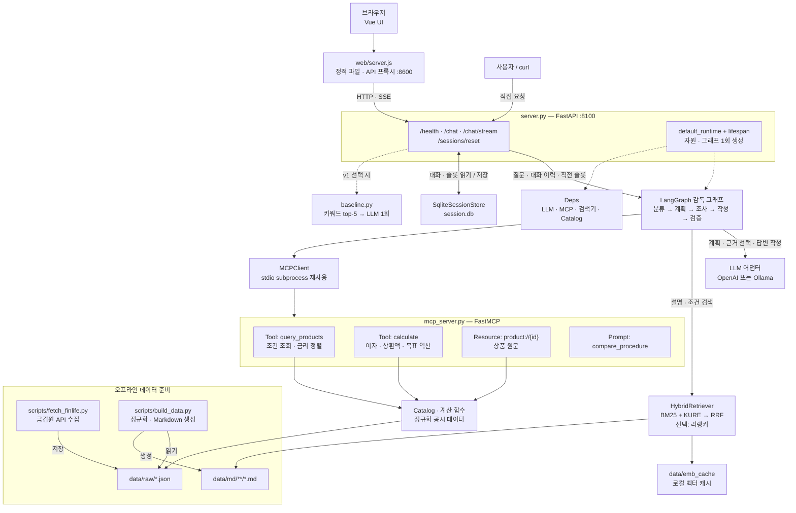
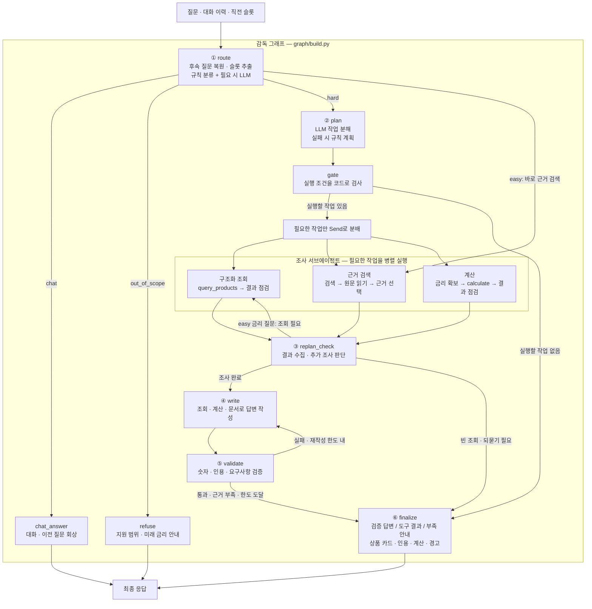

# FinAgent — 금융상품 근거 에이전트

금감원 「금융상품한눈에」 공시 상품으로 금리·가입 조건을 확인하고 이자·상환액을 계산하는 서비스입니다.
질문에 따라 조회·검색·계산 작업을 선택하고, 근거로 작성한 답변의 수치·순위·인용을 코드로 검사합니다.

## 무엇을 할 수 있나요?

- 예금·적금·주택담보대출·전세대출·신용대출 **988개 상품**을 조회하고 조건에 맞게 비교합니다.
- 공시 금리와 가입 대상을 확인하고, 예금·적금 이자와 대출 상환액을 도구로 계산합니다.
- 이전 질문을 회상하는 요청과 이전 금융 조건을 이어받는 후속 질문을 구분합니다.
- 대화에는 답변과 상품·계산 카드를 표시하고, 분석 과정과 출처는 별도 탭에서 확인합니다.

데이터는 **2026년 9월 공시 스냅샷**입니다. 실시간 금리 조회 서비스가 아니며, 현재 판매 여부나 개인별 적용 금리는 금융회사에 확인해야 합니다.

## 실행

Python 3.11 이상과 [uv](https://docs.astral.sh/uv/getting-started/installation/), Node.js 22.12 이상을 준비합니다.
아래 명령은 저장소 루트에서 실행합니다.

```bash
uv sync --frozen
uv run python scripts/build_data.py
cp -n .env.example .env
```

`cp -n`은 기존 `.env`가 있으면 덮어쓰지 않습니다.
`data/raw/*.json`에 공시 스냅샷을 포함하므로 금감원 API 키 없이 데이터를 준비할 수 있습니다.
Markdown과 임베딩 캐시는 생성물이므로 Git에 포함하지 않습니다.

`.env`에서 사용할 LLM을 설정합니다. OpenAI로 실행할 때는 다음 항목을 지정합니다.

```dotenv
LLM_BACKEND=openai
OPENAI_API_KEY=본인의_API_키
OPENAI_MODEL=gpt-4.1-mini
LANGSMITH_TRACING=false
PLANNER=llm
RAG_AGENT=react
```

다른 모델·추론 강도를 시험한 설정이 남아 있다면 `AGENT_MODEL`, `AGENT_REASONING`, `OPENAI_REASONING`은 비웁니다.
OpenAI 호출에는 본인 계정의 API 비용이 발생합니다. Ollama를 사용할 경우 `LLM_BACKEND=ollama`로 바꾸고
`OLLAMA_MODEL`에 지정한 모델을 먼저 준비합니다. 기본 모델은 다음 명령으로 내려받습니다.

```bash
ollama pull qwen3:8b
```

Ollama 앱 또는 서버가 실행된 상태에서 백엔드를 시작하세요. 상세 설정은 [.env.example](.env.example)을 참고합니다.
LangSmith 추적은 선택 사항입니다. 활성화하면 질문·답변 등 실행 정보가 외부 추적 서비스에 전송됩니다.

백엔드를 시작합니다.

```bash
uv run python -m finagent.server
```

다른 터미널에서 프론트엔드를 시작합니다.

```bash
cd web
npm ci
npm start
```

브라우저에서 **http://127.0.0.1:8600/** 을 엽니다. 백엔드 주소는 `http://127.0.0.1:8100`입니다.
첫 백엔드 실행에는 KURE 임베딩 모델과 기본 리랭커 모델 다운로드가 필요해 인터넷 연결·모델 저장 공간·메모리가 필요합니다.
메모리가 부족하면 `.env`에 `RERANK=0`을 지정할 수 있습니다. 이 경우 리랭킹을 생략하므로 검색 설정이 달라집니다.
MCP 서버는 백엔드가 로컬 자식 프로세스로 시작하므로 별도로 실행하지 않습니다.

### 종료와 포트 충돌

프론트엔드와 백엔드를 실행한 **각 터미널에서 `Ctrl+C`**를 누릅니다.
`EADDRINUSE`가 나오면 같은 포트에서 실행 중인 서버가 있는지 확인합니다. macOS에서는 다음 명령으로 PID를 찾을 수 있습니다.

```bash
lsof -nP -iTCP:8100 -iTCP:8600 -sTCP:LISTEN
```

확인한 서버 PID만 `kill <PID>`로 종료한 뒤 다시 실행하세요.

## 서비스 확인

1. `curl --fail http://127.0.0.1:8100/health`로 버전·모델·공시월을 확인합니다. 모델 호출 성공 여부는 질문으로 별도 확인합니다.
2. 웹에서 `우리SUPER주거래적금 우대조건 알려줘`를 질문하고 답변·근거를 확인합니다.
3. `우리SUPER주거래적금 월 50만원씩 12개월 세후 이자 얼마야?`로 계산 결과와 분석 과정을 확인합니다.
4. `신용대출 금리 비교해줘`로 필요한 신용점수를 되묻는지 확인합니다.

API를 직접 확인하려면 다음처럼 호출합니다. 실제 답변을 생성하므로 LLM 호출 비용이 발생할 수 있습니다.

```bash
curl --fail -N --get http://127.0.0.1:8100/chat/stream \
  --data-urlencode 'message=우리SUPER주거래적금 우대조건 알려줘' \
  --data-urlencode 'thread_id=review-1'
```

`/health` 정상 여부와 `FinalAnswer` 또는 구체적인 `Error` 이벤트를 함께 확인하세요.
공시 스냅샷 기준 정보이며 현재 판매 여부나 개인별 적용 금리를 보장하지 않습니다.

백엔드·키 없이 화면만 확인할 때는 프론트엔드 실행 후 아래 주소를 사용할 수 있습니다.

- `http://127.0.0.1:8600/?preview=easy`: 설명 답변의 계약 예시
- `http://127.0.0.1:8600/?preview=hard`: 조회·계산·검증의 계약 예시
- `http://127.0.0.1:8600/?preview=error`: 오류 화면의 계약 예시

예시 모드는 질문 내용과 관계없이 저장된 SSE를 재생합니다. 실제 에이전트·모델 실행 결과가 아닙니다.

## 아키텍처

### 서비스 구조



### 감독 그래프



LangGraph가 필요한 서브에이전트를 실행합니다. 독립 작업은 병렬로 실행하며, 조회 결과가 필요한 계산은 선행 결과를 기다립니다.
MCP는 로컬 `stdio` 연결로 상품 조회·계산 도구와 `product://{id}` 원문을 제공합니다.
LLM·검색기·MCP·세션 저장소는 의존성으로 주입하여 실제 구현과 테스트용 구현을 바꿔 연결합니다.

화면을 새로 열거나 새로고침하면 새 대화를 준비하며, 실제로 질문을 보낸 대화만 기록에 남습니다.
대화 지우기는 화면 내용과 해당 대화의 서버 문맥을 함께 초기화합니다.
분석 이벤트는 SSE로 전달하고, 검증이 끝난 답변은 화면에서 점진적으로 표시합니다. LLM 생성 토큰을 그대로 중계하는 방식은 아닙니다.

| API | 용도 |
|---|---|
| `GET /health` | 서버 상태·모델·공시월 확인 |
| `POST /chat` | JSON 요청으로 최종 답변 받기 |
| `GET /chat/stream` | 분석 이벤트와 최종 답변을 SSE로 받기 |
| `POST /sessions/reset` | 지정한 `thread_id`의 대화 문맥 초기화 |

필드와 이벤트 형식은 [API 계약](doc/API_CONTRACT.md)을 참고하세요.

## 검증과 비교

```bash
uv run pytest -q
uv run ruff check .
uv run ruff format --check .
cd web
npm test
npm run format:check
```

Python 검사는 가짜 LLM을 사용한 분기·검증과 실제 로컬 MCP 도구 등을 확인합니다.
프론트엔드 검사는 SSE 파싱·화면 출력·세션 복구·중단·프록시를 확인합니다. 이 검사 통과는 실제 모델 정답률을 뜻하지 않습니다.

2026-10-22 로컬 실행에서 Python **483개**, 프론트엔드 **43개** 테스트와 `ruff check`를 통과했습니다.
금액·기간 파싱, 수치 검증 우회, 회상 오판, 세션 초기화, 검증기 오탐 등의 회귀 테스트를 포함합니다.
이 숫자는 자동화 검사 결과이며 금융 답변 정답률이나 테스트 커버리지 수치가 아닙니다.

### 검증 정책 (API 계약 0.10.0)

- 대상(상품)·조건(기간·방식·우대조건)·항목(기본/최고, 세전/세후)·수치·단위가 근거와 다르면 반려하고 다시 작성합니다.
- 표현·순서·표 배치·의역은 허용합니다.
- 근거와 연결하지 못한 수치·설명은 반려하지 않고 `Validation.unverified` 경고로 알리며, 답 끝에 확인 안내를 붙입니다.
- 답에 쓴 계산식이 틀리면 반려합니다. 이자는 Decimal로 계산해 원 미만을 버립니다.
- 재작성 한도에 도달하면 검증된 도구 결과나 부족 안내로 답합니다.

### 평가 결과 (gpt-4.1-mini-2025-04-14)

베이스라인은 `src/finagent/baseline.py`의 키워드 top-5 검색 후 LLM 1회 호출입니다.
비교 조건은 [평가 규약](eval/BASELINE_PROTOCOL_20261021.md)에 정리했습니다.

| 평가 | 이전 | 현재 |
|---|---:|---:|
| 공정 평가셋 규칙 채점 — 베이스라인 (40문항 × 3회) | 82/120 | 83/120 |
| 공정 평가셋 규칙 채점 — 감독 그래프 | 72/120 | **120/120** |
| 감독 그래프 오답인데 검증 통과 | 6 | **0** |
| 감독 그래프 정답인데 검증 반려 | 0 | 9 |
| 골든셋 50문항 (1회) | 49/50 | **49/50** |

- 공정 평가셋은 같은 40문항을 3회 반복한 결과라 120건이 서로 독립적이지 않습니다. 규칙 채점은 정답 값·상품명·동률·명시 조건만 확인합니다.
- 골든셋은 검증 기준 정리 후 48/50으로 떨어졌다가 오탐 수정(최고우대금리, 고정/변동금리 동일값)으로 49/50이 됐습니다. 남은 오답은 후속 질문 F2입니다.

## 한계와 선택

- 근거 검사는 수치·인용·일부 조건을 코드로 검사합니다. 검증 통과가 답 전체의 정확성을 보장하지 않으며, 의미 품질은 LLM 판정(평가용 judge)에 맡깁니다.
- 맞는 답을 반려하는 오탐이 남아 있습니다(골든셋 H1: 여러 상품을 한 문장에 묶은 금리, N18: 공시 한도 금액). 이때는 검증되지 않은 도구 결과 목록으로 답합니다.
- 하이브리드 재채점(코드 검산 + LLM judge)은 평가기를 바꿔 이전 결과와 직접 비교할 수 없어 이번 수치에 포함하지 않았습니다.
- KURE 임베딩 검색의 재현율(recall)은 따로 측정하지 않았습니다.
- 후속 질문의 이전 조건 이어받기가 불완전한 경우가 있습니다(골든셋 F2).
- 조건이 부족하거나 근거가 없으면 되묻거나 답변을 제한합니다. 개인별 심사 결과를 예측하거나 금융상품 가입을 대신하지 않습니다.
- 계획·근거 검색·검증은 단일 LLM 호출보다 비용과 지연이 늘 수 있습니다. 첫 모델 로딩·다운로드도 별도 시간이 필요합니다.
- 현재 UI의 대화 목록은 브라우저 로컬 저장소, 서버 문맥은 로컬 SQLite에 저장합니다. 인증·사용자별 접근 제어가 없는 로컬 시연용 구성입니다. 기본 바인딩을 유지하고 외부에 그대로 공개하지 마세요.

## 주요 파일

| 경로 | 역할 |
|---|---|
| `src/finagent/server.py` | FastAPI 시작점, `/chat`, `/chat/stream`, 세션 저장 연결 |
| `src/finagent/graph/` | 질문 분류·계획·서브에이전트·답변 검증 흐름 |
| `src/finagent/mcp_server.py` | 상품 조회·계산 도구, 상품 원문, 답변 절차 제공 |
| `src/finagent/catalog.py` | 구조화 조회·금리 정렬·계산 |
| `src/finagent/llm.py`, `schemas.py` | 모델 호출 어댑터와 구조화 입출력 모델 |
| `src/finagent/amounts.py`, `slots.py` | 금액·기간·질문 조건 추출과 회상 분류 |
| `src/finagent/requirements.py`, `validate.py`, `provenance.py` | 요청 누락·근거 모순·수치·인용·계산식 검사, 수치의 상품·조건·항목 연결 |
| `src/finagent/retrieval.py`, `evidence.py` | 하이브리드 검색과 근거 선택 |
| `src/finagent/session_store.py` | 서버 대화·조건 저장 |
| `data/raw/` | 재현용 공시 데이터 스냅샷 |
| `web/src/` | Vue 화면과 세션·스트리밍 composable |
| `doc/API_CONTRACT.md`, `doc/contract/` | API 계약과 화면 재생용 SSE 예시 |
| `tests/`, `eval/` | 동작 검증과 베이스라인 대비 비교 코드·평가 입력 |
